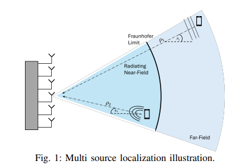
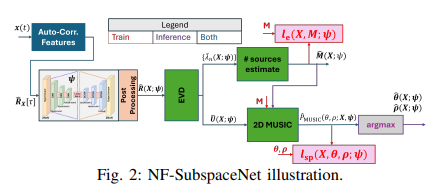
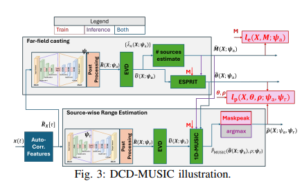
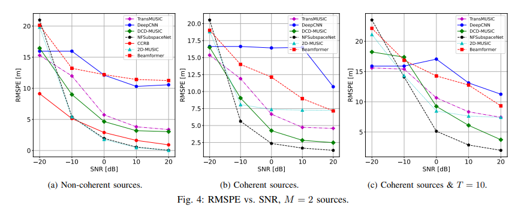
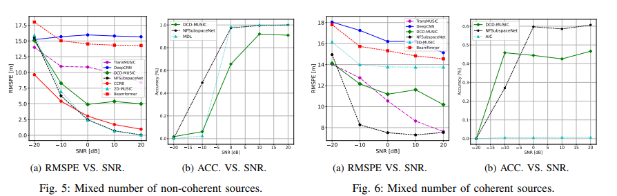
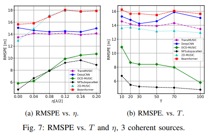
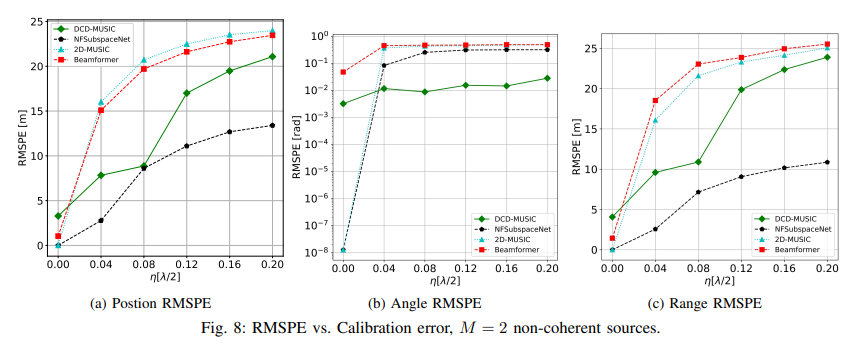
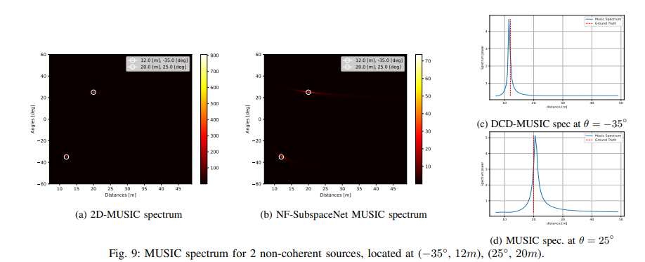
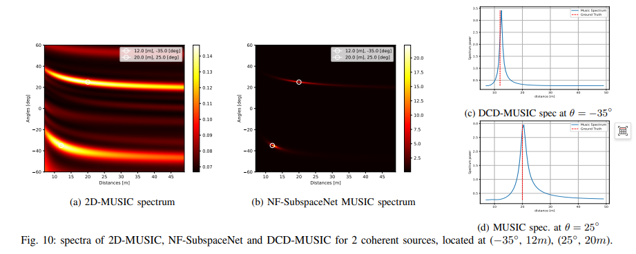
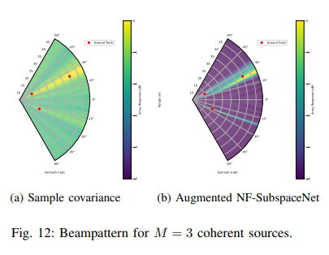

# DOA Estimation: When MUSIC Meets Deep Learning: The AI Breakthrough in Near-Field Positioning [with Python Code]

When MUSIC meets deep learning: AI breakthrough in near-field positioning for 6G ultra-large arrays and millimeter wave era, users have "ducked" into the near-field of antennas. While traditional MUSIC continues to perform a two-dimensional exhaustive search, research that integrates deep learning into subspace methods has provided a new answer.
After a rapid acceleration in speed, positioning has become a new bottleneck for wireless communication. To feed the next generation of systems, the engineering community has pushed two "heavy weapons" to the forefront: ultra-large arrays (XL-MIMO, holographic surfaces) and millimeter waves, even into the Asia-Pacific Hertz band.
However, this combination has led to an overlooked physical fact—as the antenna aperture gets larger and the wavelength shorter, the Fraunhofer distance is pushed to dozens of meters away. In other words, a large number of users are no longer in the far-field as traditionally assumed but fall into the radiation near-field of the array.
This change in the nature of the positioning problem:
Far-field: The wavefront is approximately planar, and the array can only measure the angle of arrival (DOA);
Near-field: The wavefront is spherical, and the phase accumulates nonlinearly with the order of elements, allowing both angle and distance to be estimated simultaneously.
Near-field positioning is not just about "adding one more parameter." Only knowing the user's three-dimensional position can the base station launch the key focused beam in the millimeter wave band. Positioning has become a prerequisite for near-field communication.
In response to near-field positioning, the family of subspace methods (represented by MUSIC and its extensions) remains the benchmark for resolution and interpretability: feature decomposition on the sample covariance matrix, noise subspace orthogonal to the steering vector, searching over the two-dimensional spectral peaks, revealing angle and distance at a glance.
The problem lies in the assumptions upon which this process is based, often breaking down in real systems:
First, coherent sources. In multipath environments, signals are highly correlated, and the rank of the covariance matrix severely drops, causing the signal subspace to collapse, leaving only a blurred spectrum on the MUSIC plot.
Second, array mismatch. The actual position of the elements deviates from their nominal values, leading to distortion in the steering vector model—the larger the array, the more difficult it is to calibrate, which is particularly fatal.
Third, insufficient number of samples. Covariance estimation requires a sufficient number of fast-sampling points, but in high-speed moving scenes, you often have only a few samples.
Pure deep learning methods (such as direct regression based on Transformer or CNN) are another path, but they have massive parameters, rely on massive labeled data, and lose the most valuable thing in subspace methods: interpretable spectral structure, and the ability to judge the number of sources from the feature spectrum.
Is there a way to achieve both?
03 Idea: Let the network create a "clean" covariance matrix. The answer given by researchers from Israeli and French institutions is not to let AI replace MUSIC, but to let AI prepare for MUSIC.
The core idea is derived from SubspaceNet in far-field scenarios: train a convolutional autoencoder to map the self-correlation features of the observed signal into an "agent covariance matrix," as if all troublesome issues such as coherence, mismatch, and few samples were nonexistent. Subsequent subspace decomposition and spectral peak search are still left to classic algorithms.
The model is the model, and learning is learning, with interpretability fully preserved.
But bringing this setup into near-field presents a technical chasm: far-field solutions rely on ESPIRIT, Root-MUSIC, and other differentiable algorithms to end-to-end backpropagate gradients, while near-field MUSIC's peak search cannot be differentiable. Without gradient transmission, the network cannot train.
04 Strategy One: NF-SubspaceNet - Directly Supervise MUSIC Spectrum. The breakthrough point of NF-SubspaceNet is to move the loss function from "final position" to "MUSIC spectrum":
No longer requiring network predictions to correctly estimate angle distances, but encouraging the noise subspace to be as orthogonal to the steering vector at the true source position—that is, making the MUSIC spectrum approach a peak at the true location. The spectrum is completed supervision before peak search, and the entire link (CNN, differentiable feature decomposition, tensor operations) is end-to-end trainable.
There are two finely designed architectures: 1) Normalizing the agent covariance by spectral norm for normalization, suppressing fluctuations in feature values; 2) Introducing learnable jump coefficients constrained by (0,1), performing residual correction on empirical covariance.
During inference, the feature values of the agent covariance are directly used for source number estimation, generating a two-dimensional MUSIC spectrum with a M-peak representing the positions of M sources. It can also handle near-far field scenarios: sources located beyond the search limit are automatically classified as far-field.

Strategy Two: DCD-MUSIC - breaking down the two-dimensional search into a one-dimensional cascade of two-dimensional grid searches is a computational bottleneck for near-field MUSIC. The second solution, DCD-MUSIC, changes the approach: instead of adapting to near-field without modification, it transforms the signal statistics into a form suitable for far-field, using the ESPRIT-MUSIC cascade framework to decouple angles and distances:
- Angle level: A DNN outputs far-field-like agent covariance, which is then solved using a differentiable ESPRIT closed-form for all angles;
- Distance level: Another DNN outputs another agent covariance, performing one-dimensional MUSIC distance search for each estimated angle.
The cascading structure allows training to proceed in three steps: first train the angle network, then the distance network (coupled with a differentiable MaskPeak approximation, training early stages using real angles as "warm-up"), and finally tune jointly in Cartesian coordinates.
In terms of complexity, replacing two-dimensional grid searches with a next-dimension search reduces inference time to 5.7 milliseconds, approximately 294 million multiplications — nearly three times faster than the data-driven DeepCNN baseline and only seven percent of its computational load. In practice, it shows "untrained" adaptability to both near-far field sources.
A key overlooked aspect: teaching the network to "count sources"
Another point that is often overlooked is model order perception training.
The subspace method is an indispensable aspect of product technology. Here, classic criteria such as threshold methods, MDL, and AIC are directly incorporated into the loss function: not only must the network be accurate in localization, but it should also allow the agent feature spectrum to "grow" large enough for downstream criteria to correctly segment the signal and noise subspaces. 
How robust is this approach? In coherent source scenarios, the accuracy rate of source number discrimination using traditional 2D-MUSIC combined with MDL drops to zero%, while NF-SubspaceNet combined with AIC achieves a rate of 58.5%—from complete failure to over half usability. 
07 What does the experiment say? The simulation covers all scenarios that MUSIC fears most: 
Coherent sources: The position error of 2D-MUSIC soars to 13.8 meters, while both AI-assisted methods stabilize at around 7 meters, and the spectral plot remains clearly discernible; 
Rarely sampled data: Even when T=10, NF-SubspaceNet remains stable; 
Array mismatch: On a 64-element array operating at 5GHz (far from the Friedmann distance of about 120 meters), DCD-MUSIC performs almost constant performance across different intensity calibration errors, while data-driven benchmarks fail to converge under 100,000 samples; 
Explainability: Under coherent sources, the classic MUSIC spectrum has "blurred together," yet AI-assisted methods still provide clear-cut spectral peaks, and the agent covariance can even be directly used for MVDR beamforming. 
Trained with 4096 samples, it outperforms TransMUSIC and DeepCNN with larger parameter sizes—the model's prior here is not a burden but a source of data efficiency. 
08 In conclusion, the value of this work lies not in refreshing a certain metric with neural networks but in demonstrating a practical path: AI does not take over algorithmic tasks, but instead supplements the model's assumption gaps. The interpretability and analytical properties of classic methods remain unchanged, while their robustness is filled in by data. 
For radar and array signal processing colleagues, this framework's potential goes beyond just localization: extensions to plane array three-dimensional near-field localization, sparse arrays, and joint learning of localization-tracking are already under discussion.
The gates of the near-field era have been opened, and MUSIC has not yet concluded its performance—it has merely changed its mode of presentation.

## Images

<!-- PAYMENT_BLOCK -->

## Get this dataset

- Payment link (Stripe): [Buy now](https://buy.stripe.com/3cs8yP7sY87d0vu9AB)
- Payment QR code: 

<!-- /PAYMENT_BLOCK -->
